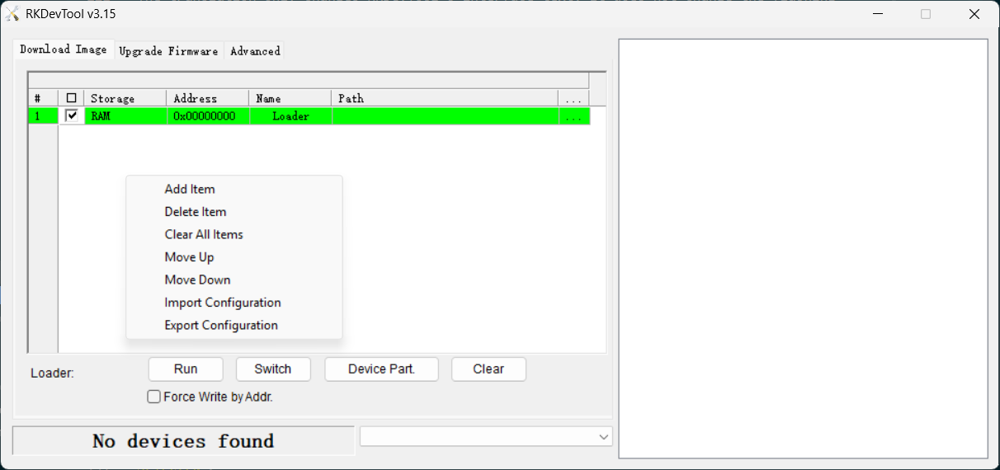
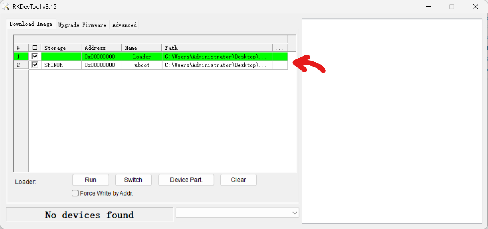
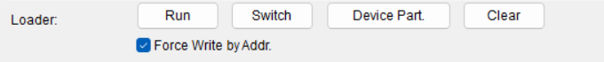

# USB Drive Installation

This page covers booting PhotonVision from a USB drive or SSD instead of a microSD card. For the standard microSD installation, see the {ref}`Quick Install guide <docs/quick-start/quick-install:Raspberry Pi and Orange Pi Installation>`.

```{note}
For USB drives, best practice is to use a name brand 8 GB+ USB 3.0 or newer drive from an authorized retailer (ideally not marketplace-type websites) or a reputable modern SSD in a suitable enclosure.

Generic and/or low-quality drives are more prone to data corruption, failure, and performance issues.
```

Most boards supported by PhotonVision can boot from USB drives, but some require a bootloader update or configuration before USB boot will work. The following sections cover the required setup for boards that need it.

## Bootloader Update/Configuration
::::{tab-set}
:::{tab-item} Raspberry Pi 3 series
```{note}
The Raspberry Pi 3B+ already has USB mass-storage boot enabled by default, so this procedure is not needed.

For Raspberry Pi 3B and other supported pre-3B+ models that do not already have USB host boot enabled, this procedure is required.

Programming the OTP is permanent, but it does not prevent the Pi from booting from microSD cards. On the Raspberry Pi 3A+, enabling USB host boot permanently disables USB device boot mode.
```
```{note}
If you are using a Compute Module with eMMC you will need to download [rpiboot](https://github.com/raspberrypi/usbboot) for your operating system, and run it before the first step.

Before using rpiboot, ensure that the Compute Module is in bootloader mode. Refer to your baseboard's documentation for instructions.
```

1. Download [Raspberry Pi Imager](https://www.raspberrypi.com/software/)

2. Select Raspberry Pi 3

3. Select Raspberry Pi OS (64-bit), then your storage device, and flash the image onto a microSD card.

4. (microSD-only) Insert the microSD card into the Raspberry Pi 3

5. Connect power and HDMI to a display, boot it normally, and follow the onscreen instructions.

6. Open the terminal, and update the Raspberry Pi OS installation:

```shell
sudo apt update
sudo apt full-upgrade
```

7. Enable USB boot mode by programming the OTP:

```shell
echo program_usb_boot_mode=1 | sudo tee -a /boot/firmware/config.txt
sudo reboot
```

8. Verify that the OTP bit has been programmed:

```shell
vcgencmd otp_dump | grep 17:
```

The output should contain:

```text
17:3020000a
```

9. (optional) Remove the USB boot configuration from config.txt:

Once the OTP has been successfully programmed, you can remove the following line from /boot/firmware/config.txt if you want:

```text
program_usb_boot_mode=1
```
This setting is only required to program the OTP and does not need to remain enabled.

10. Shut down the Raspberry Pi 3 and remove the microSD card from the microSD slot.
:::

:::{tab-item} Raspberry Pi 4/5 series
```{note}
If you are using a Compute Module with eMMC you will need to download [rpiboot](https://github.com/raspberrypi/usbboot) for your operating system, and run it before the first step.

Before using rpiboot, ensure that the Compute Module is in bootloader mode. Refer to your baseboard's documentation for instructions.
```

1. Download [Raspberry Pi Imager](https://www.raspberrypi.com/software/)

2. Select your Raspberry Pi model

3. Scroll down to "Misc utility images" and select "Bootloader (Pi [model] Family)"

4. Select "USB boot" or "NVMe/USB boot" (depending on your model)

5. Select your microSD card (or device) and flash the bootloader image

6. (microSD-only) Insert the microSD card into your Raspberry Pi

7. Power the device on. The bootloader will be updated and configured to boot from USB before microSD.

8. Wait for the green LED to blink rapidly, indicating that the update was successful. If an HDMI display is connected, the screen will also turn green. A red screen indicates that the update was unsuccessful.

9. Power off the Raspberry Pi and remove the microSD card.
:::

:::{tab-item} Rockchip-based boards (Orange Pi 5/5+, etc.)

Tested on the Orange Pi 5 and 5+.

Other Rockchip boards may require different files, buttons, USB ports, bootloaders, or flashing procedures. Follow your board's official documentation and use the files provided for your specific board.

Some Rockchip boards ship with an older SPI bootloader that does not support USB boot and must be updated before booting PhotonVision from USB.

The SPI bootloader update is separate from PhotonVision installation and normally only needs to be done once, unless a newer bootloader is released.

```{note}
This RKDevTool procedure requires Windows. For now, other operating systems are not supported.

This guide uses a corrected English translation for RKDevTool. Installing it is highly recommended because the button names and messages below match the corrected translation rather than the original, poorly translated English interface.

The translation only changes RKDevTool's interface text and does not change the application itself or anything on your board.

If the download is blocked, your web browser may need you to manually approve that file.
```

## Links
RKDevTool: [Download](https://drive.google.com/file/d/1ypZnxyPEQE4TwLucElpccjmGMqwtoNB0/view?usp=drive_link)

Drivers: [Download](https://drive.google.com/file/d/1kTWzTh1TYBTVsv6mPDXKfLIqrImz-7gl/view?usp=drive_link)

Unofficial RKDevTool Translation: [`English.ini`](additional-files/English.ini)

## Board-specific files
Click the file names to download the correct files for your board. If your board is not listed, consult your board's official documentation for the correct files.

| Board | SPI flash configuration | Temporary loader | SPI bootloader |
| ----- | ----------------------- | ---------------- | -------------- |
| Orange Pi 5 / 5+ | [`rk3588_linux_spiflash.cfg`](https://drive.google.com/file/d/1gLtVkRo21dOLxp-muqh01Him3ykWV_NV/view?usp=drive_link) | [`MiniLoaderAll.bin`](https://drive.google.com/file/d/1a79ElLfNc7RF1wS3U0pKCLfn-ygokZR9/view?usp=drive_link) | [`rkspi_loader.img`](https://drive.google.com/file/d/1XatmhEUU97JwSEq3F87SQq1iAaxTIK_V/view?usp=drive_link) |

1. Download RKDevTool, the Rockchip USB drivers, and the corrected `English.ini` (from above).

2. Extract RKDevTool and make backup copies of its original `config.ini` and `Language\English.ini`.

3. Edit `config.ini` so RKDevTool uses the English language file, then replace the original `English.ini` with the corrected version.

To edit `config.ini`, find the section below, and change the line `Selected=1` to `Selected=2` so it reads as follows:

```ini
[Language]
Kinds=2
Selected=2
LangPath=Language\
```

4. Install the Rockchip USB drivers, then open RKDevTool.

Double-click on `DriverInstall.exe`, allow it to run as administrator, and click on "Install Driver". Wait for the process to finish before proceeding. Once it finishes, you can close the application.

![RKDriverAssitant [sic] install](images/rkdevtool/driver_install.png)

5. Download the board-specific SPI flash configuration, temporary loader, and SPI bootloader image listed above.

6. Import the SPI flash configuration into RKDevTool by right-clicking anywhere in the table area and selecting "Import Configuration".

7. Select the temporary loader as the loader and SPI bootloader image as the U-Boot image. For each file, click the corresponding box under the "..." in the table and select the correct file.

8. Connect the board's programming USB port to the computer.

9. Enter MaskROM mode using the method specified for your board.

For the Orange Pi 5 and 5+, hold the MaskROM button while connecting the board's power USB-C port to the same computer.

Other boards may require you to connect a jumper, short specific pins, or hold a different button. Consult your board's official documentation for the correct procedure.

```{warning}
For boards that use two USB-C connections for power and data, connect both cables to the same computer. Do not connect the power cable to a separate power supply.

For boards with different power requirements, follow the manufacturer's documentation for the correct flashing procedure.
```

10. Confirm that RKDevTool detects the board in MaskROM mode. In the bottom-left corner of the window, it will say "Found One MaskROM Device".

```{note}
If it says "No devices found" or anything else:
- Check your USB connection and drivers
- Make sure only one device is connected to the computer
- Ensure the board is powered on and working

If the board is still not detected, try using a different USB port or cable. Some USB-C cables are power-only and do not support data transfer.
```

11. Tick the "Force Write by Addr." checkbox, then click "Run".

12. Wait for RKDevTool to report that the operation completed successfully in the log section on the right.

RKDevTool is only being used here to update the U-Boot-based bootloader stored in SPI flash. PhotonVision itself is stored on the separately prepared boot device.
:::
::::

## Flashing the USB drive
1. Download the PhotonVision image for your supported device and Raspberry Pi Imager.
2. Use Raspberry Pi Imager to write the image to a USB drive.
3. Connect the USB drive to a USB 3.0 port on the board.
